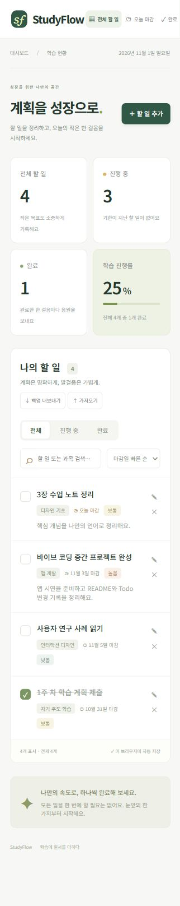

# StudyFlow — 학습 할 일 관리 앱

> 학습 계획을 작은 할 일로 나누고, 마감일과 완료 현황을 한눈에 확인하는 웹 앱입니다.

소스 저장소: [2112336874hh-beep/studyflow](https://github.com/2112336874hh-beep/studyflow)

GitHub 업로드를 완료했습니다. 공개 온라인 데모는 아직 활성화하지 않았습니다. 아래 실행 방법으로 앱을 사용할 수 있습니다. 공개 데모를 원하면 저장소의 Pages 설정에서 GitHub Actions를 선택하고 제공된 수동 워크플로를 실행할 수 있습니다.

이 프로젝트는 **기존 실습 과제를 제출하지 않은 경우에 해당하는 신규 중간고사 프로젝트**입니다. 앱 화면, 안내 메시지, 예시 데이터 및 과제 설명을 한국어로 제작했습니다.

## 1. 제작한 것 소개

대학생은 여러 과목의 과제와 복습 일정을 동시에 관리해야 합니다. StudyFlow는 과목별 할 일을 등록하고 마감일, 우선순위, 완료 상태를 관리하여 다음에 해야 할 일을 쉽게 선택하도록 돕습니다.

- 할 일 추가·수정·삭제, 과목과 메모 기록
- 마감일과 우선순위 설정, 오늘 마감 및 기한 초과 표시
- 완료/미완료 전환 및 전체·진행 중·완료 통계
- 완료율과 진행 막대
- 제목·과목 검색, 상태 필터, 마감일·우선순위·최근 생성순 정렬
- 브라우저에 자동 저장, JSON 백업 내보내기 및 병합 가져오기
- 모바일과 데스크톱 대응 화면

처음 방문하면 예시 할 일 4개가 표시됩니다. 자유롭게 수정하거나 삭제할 수 있습니다. 실제 학생의 개인정보나 과제 데이터는 포함하지 않습니다.



### 실행 방법

Node.js 18 이상을 설치한 뒤 프로젝트 폴더에서 실행합니다. 외부 패키지 설치는 필요 없습니다.

```bash
node server.cjs
```

브라우저에서 `http://127.0.0.1:4173`을 엽니다. 확인 명령은 `node --check dist/app.js`와 `node --check server.cjs`입니다. npm이 설치되어 있으면 `npm start`, `npm run check`도 사용할 수 있습니다. 파일을 직접 더블 클릭하기보다는 위 로컬 서버나 HTTPS 정적 호스팅으로 실행하는 것을 권장합니다.

### 구성

```text
dist/                  실제 웹 앱 (HTML, CSS, JavaScript)
docs/PRD.md            요구사항 문서
docs/TODO.md           최초 계획, 최종 Todo, 변경 이력
docs/TESTING.md        실제 확인 결과와 재현 절차
docs/PRESENTATION.md   발표 순서 및 시연 안내
skills/*/SKILL.md      작업에서 참고한 기존 스킬 원문
server.cjs             외부 의존성 없는 로컬 실행 서버
```

HTML, CSS, 바닐라 JavaScript와 localStorage를 사용했습니다. 서버 데이터베이스와 회원가입 기능은 없습니다. 데이터는 현재 브라우저와 주소에만 저장되며 다른 기기와 자동 동기화되지 않습니다. 브라우저 데이터를 삭제하면 기록도 삭제되므로 JSON 백업을 이용할 수 있습니다. 글꼴은 인터넷 연결 시 Google Fonts에서 불러오고, 연결이 없으면 시스템 글꼴을 사용합니다.

## 2. PRD와 Todo 리스트

전체 요구사항은 [PRD](docs/PRD.md), 최초·최종 계획 및 변경 기록은 [Todo 리스트](docs/TODO.md)에 있습니다.

처음 계획한 핵심 범위:

- [x] 할 일 추가
- [x] 마감일 설정
- [x] 완료 상태 전환
- [x] 완료율 표시
- [x] 개발 과정과 사용 스킬 문서화

최종 추가 범위:

- [x] 과목·메모·우선순위와 수정 기능
- [x] 삭제 전 확인
- [x] 검색·필터·정렬
- [x] 브라우저 자동 저장과 JSON 백업
- [x] 오늘 마감 보기, 반응형 화면, 예시 데이터

## 3. Todo 리스트의 변경 내역

| 최초 계획 | 최종 변경 | 이유 |
| --- | --- | --- |
| 이름과 마감일 중심의 간단한 등록 | 과목·우선순위·메모 추가 | 여러 수업의 과제를 구분하고 다음 작업 선택을 돕기 위해 |
| 추가와 완료 전환 중심 | 수정 및 삭제 확인 추가 | 잘못 입력한 과제를 고치고 실수로 삭제하는 일을 줄이기 위해 |
| 전체 목록 보기 | 검색·상태 필터·오늘 보기·정렬 추가 | 할 일이 늘어나도 원하는 항목을 찾기 쉽게 하기 위해 |
| 저장 방식 미정 | 브라우저 자동 저장 선택 | 로그인 없이 바로 실행 가능한 중간고사 범위로 만들기 위해 |
| 백업 없음 | JSON 내보내기/병합 가져오기 추가 | 기기 간 자동 동기화가 없는 한계를 보완하기 위해 |
| 사용 방식 미정 | 신규 브라우저에서 예시 4개 제공 | 발표할 때 앱의 용도를 바로 이해할 수 있도록 하기 위해 |
| 제출 방식 구체화 전 | GitHub 제출용 문서·소스 구성 | 사용자가 GitHub 업로드 요구사항을 추가로 확인했기 때문 |
| 초기 중국어 화면 | 한국어 화면·알림·예시·날짜 형식으로 전환 | 사용자가 한국어판을 요청했기 때문 |

이는 같은 신규 프로젝트 안에서의 계획 대비 변경이며, 이전에 제출한 실습 결과물과의 비교가 아닙니다. 변경을 브라우저 테스트로 발견한 것처럼 꾸미지 않고, 구현 중 선택과 실제 테스트 결과를 구분했습니다.

## 4. 사용한 스킬

직접 만든 스킬은 없으며 다음 기존 스킬을 참고했습니다. 원문 전체를 저장소의 각 `SKILL.md` 파일에 포함했습니다. 이 파일들은 실행 의존성이 아닌 제작 과정의 증빙이며, 원문에 언급된 외부 보조 스크립트는 앱 실행에 필요하지 않습니다.

| 스킬 | 선택한 이유 | 실제 사용 방식 및 결과 |
| --- | --- | --- |
| [Sites](skills/sites/SKILL.md) | 작은 웹 앱의 제작·미리보기·검증 흐름이 필요해서 | 빌드가 필요 없는 HTML/JS 방식 선택, 화면 구현, 로컬 서버 미리보기, 정적 배포용 구성. Sites 원격 게시 완료 여부와 GitHub 업로드 완료 여부는 별도로 확인해야 함 |
| [Plugin Management](skills/plugin-management/SKILL.md) | GitHub 제출을 위해 연결 가능한 도구를 확인하려고 | GitHub 플러그인 검색 및 연결 안내. 검색 자체를 설치/연결 완료로 취급하지 않음 |
| [Computer Use](skills/computer-use/SKILL.md) | 브라우저 시연 및 GitHub 화면 확인 작업을 위해 | UI 자동화 지침을 읽고 폼 입력과 화면 확인에 참고. Edge 접근은 현재 주소 확인 문제로 중단되었으므로 업로드 성공으로 기록하지 않음 |

### 바이브 코딩 과정

1. 학생용 학습 할 일 앱이라는 목적과 핵심 기능을 대화로 정했습니다.
2. AI 코딩 도구로 화면과 기능을 구현했습니다.
3. 구현 중 필요한 기능을 보완하고 최초 계획과의 차이를 기록했습니다.
4. 로컬 브라우저에서 할 일 등록 및 통계 변화를 확인하고, 추가 확인 결과는 [테스트 기록](docs/TESTING.md)에 남겼습니다.
5. GitHub 제출용으로 소스와 문서를 정리했습니다. 발표 전 작성자가 직접 실행하고 기능과 코드를 이해하는 과정이 필요합니다.

## 발표와 한계

[발표 순서 및 시연 안내](docs/PRESENTATION.md)를 따라 목적 → PRD → 동작 시연 → Todo 변경 → 스킬 활용 → 한계 순으로 설명할 수 있습니다. 초기 전달된 과제 안내는 스킬 설명 항목 중간에서 끊겨 있었으므로, 나머지 안내의 추가 제출 조건은 별도로 확인해야 합니다.

현재 한계는 로그인·클라우드 동기화·푸시 알림이 없다는 점입니다. 학습용 단일 사용자 앱으로 범위를 정했고, 이후 캘린더 연동과 계정별 동기화를 발전 방향으로 고려할 수 있습니다.
